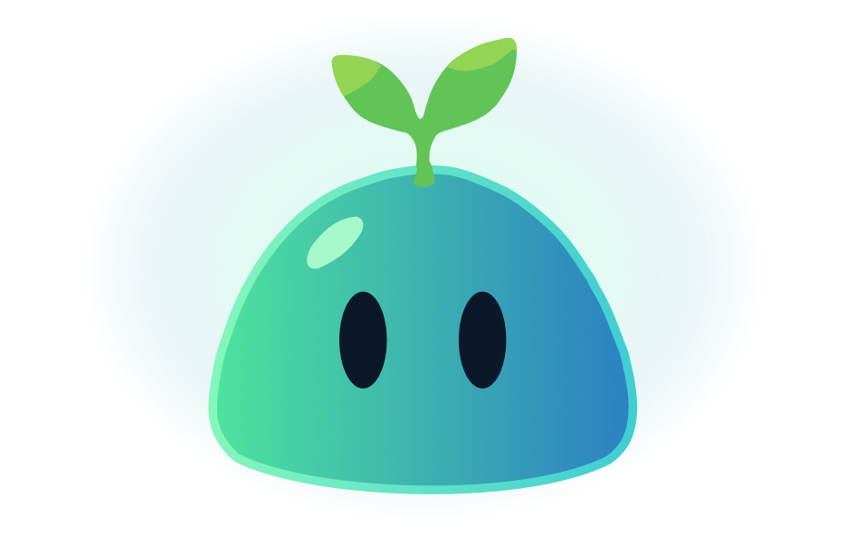
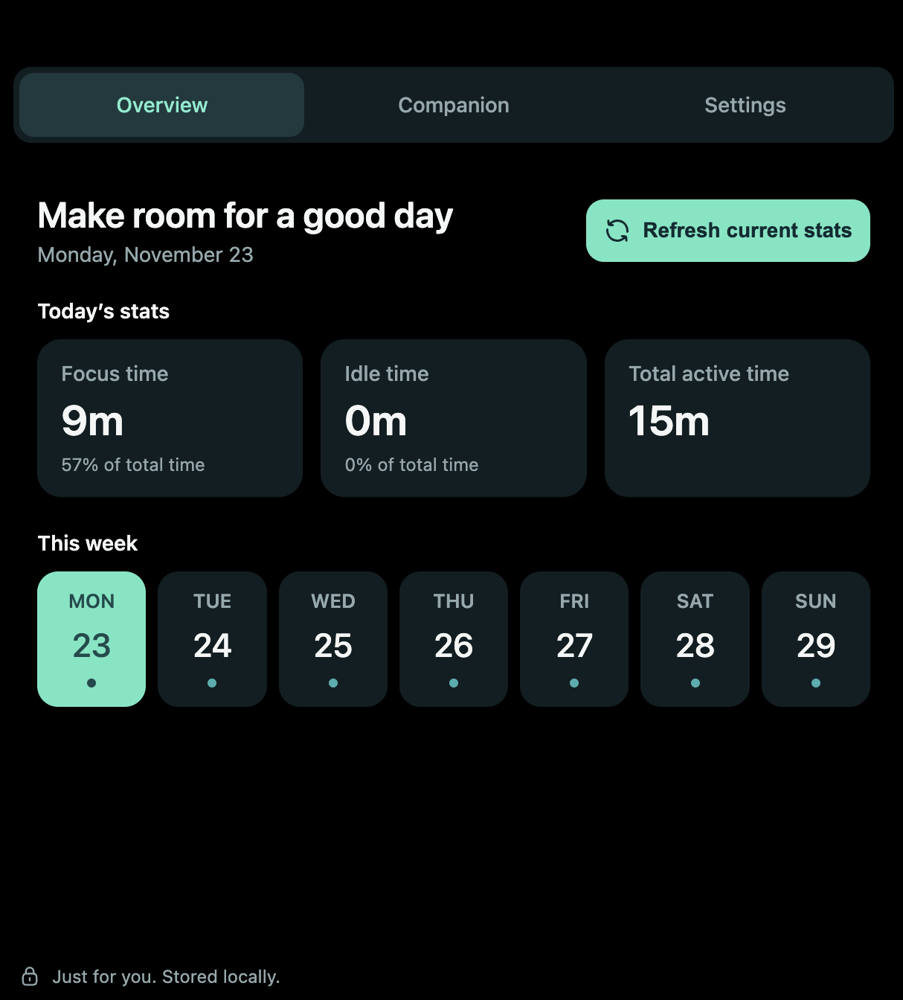
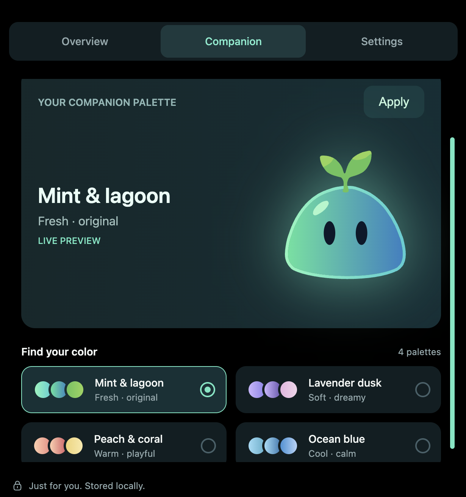

<p align="center">
  
</p>

# Gelly

A small desktop companion that lives on your screen. Gelly is a squishy green blob with a leaf on its head. It floats above your windows, follows your cursor with its eyes, dances, falls asleep when you step away, and keeps an overview of your day in a notch at the top of the screen.

[](LICENSE)
[](LICENSE-ART)
[](https://github.com/sponsors/ar2r-p003)

> **Source-available, free for noncommercial use.** You can use Gelly, read the code, modify it and share it, but you may not sell it or use it commercially, and the character artwork can't be copied. See [License](#license). This is not an OSI-approved "open source" license.

## Features

- **Always-on-top companion**: a transparent, frameless window that stays above other windows, including fullscreen apps
- **Drag it anywhere**: it stays inside the screen edges and works across multiple monitors
- **Alive**: breathing, blinking, leaf sway, eyes that follow your cursor
- **Dance and sleep**: it dances on request and falls asleep when you're idle, with floating *z*s
- **Notch overview**: a hover-activated panel with your daily activity and settings
- **Customizable**: personalize your Gelly with changing colors
- **Remembers you**: settings and daily stats are saved between launches

<table>
  <tr style="border: none">
    <td width="50%" style="border: none"></td>
    <td width="50%" style="border: none"></td>
  </tr>
</table>

## Download

Get the latest installer from the [Releases](https://github.com/ar2r-p003/gelly/releases) page.

| Platform | File |
|---|---|
| Windows 10/11 (x64) | `gelly-<version>-setup.exe` |
| macOS (Apple Silicon and Intel) | `gelly-<version>.dmg` |

Linux is not supported.

### The app is not code-signed

I can't afford signing certificates, so your OS will warn you the first time. The warnings are expected for unsigned apps. Only install builds from this repository's Releases page.

**Windows:** if SmartScreen shows "Windows protected your PC", click **More info**, then **Run anyway**.

**macOS:** if you see "Gelly is damaged" or "cannot be verified":

1. Drag Gelly to `/Applications`.
2. Open **System Settings → Privacy & Security**, scroll down and click **Open Anyway**.
3. If that doesn't work, run this in Terminal and open the app again:
   ```bash
   xattr -cr /Applications/Gelly.app
   ```

Because the app is unsigned, automatic updates aren't available on macOS. Download new versions manually.

## Privacy

- Everything stays on your computer. There is no account, analytics or telemetry.
- Daily activity totals (time spent active, idle and in your chosen focus app) are stored in a local file in your user data folder.
- To work out which app is in focus, Gelly reads the **name of the foreground application**. It does not read window titles, screen contents, keystrokes, files or clipboard data.

You can delete all saved data by removing Gelly's folder in your user data directory (`%APPDATA%\Gelly` on Windows, `~/Library/Application Support/Gelly` on macOS).

## Support the project

Gelly is free and made in my spare time. I will update it during time with more cool features. If you enjoy it, you can support development through [GitHub Sponsors](https://github.com/sponsors/ar2r-p003). Sponsoring is entirely voluntary and doesn't unlock anything. Starring the repo or reporting bugs helps just as much.

## Development

Requirements: Node.js 22 or newer, npm. For windows python and C++ build tools are also required.

```bash
git clone https://github.com/ar2r-p003/gelly.git
cd gelly
npm ci
npm run dev
```

| Command | What it does |
|---|---|
| `npm run dev` | Start in development mode |
| `npm run typecheck` | Type-check the main and renderer code |
| `npm run lint` | Run ESLint |
| `npm run format` | Format with Prettier |
| `npm run build:unpack` | Build an unpacked app for testing |
| `npm run build:win` | Build the Windows installer |
| `npm run build:mac` | Build the macOS disk image |

Build the Windows installer on Windows and the macOS image on a Mac. Test the **packaged** app before a release, because some things (icons, launch at login, the focused-app lookup) behave differently from dev mode.

### Tech

Electron, React, TypeScript and electron-vite, packaged with electron-builder.

## Contributing

Issues and pull requests are welcome. By submitting a contribution, you agree that it is provided under the same terms as the rest of the project: code under the PolyForm Noncommercial License 1.0.0, and any artwork under CC BY-NC-ND 4.0 with the rights needed for it to ship in Gelly.

## License

Gelly uses two licenses.

| What | License | In short |
|---|---|---|
| **Code** | [PolyForm Noncommercial 1.0.0](LICENSE) | Use, modify and share for noncommercial purposes. No selling or commercial use. |
| **Artwork**: the character (blob and leaf, including the SVG in `Companion.tsx`), the icons and the name "Gelly" | [CC BY-NC-ND 4.0](LICENSE-ART) | Share unmodified with credit, noncommercially. No copying into your own work, no edits, no selling. |

If you fork Gelly and share a modified version, replace the character artwork, the icons and the name with your own.

Third-party dependencies keep their own licenses.

Copyright © 2026 Artur Petrosyan